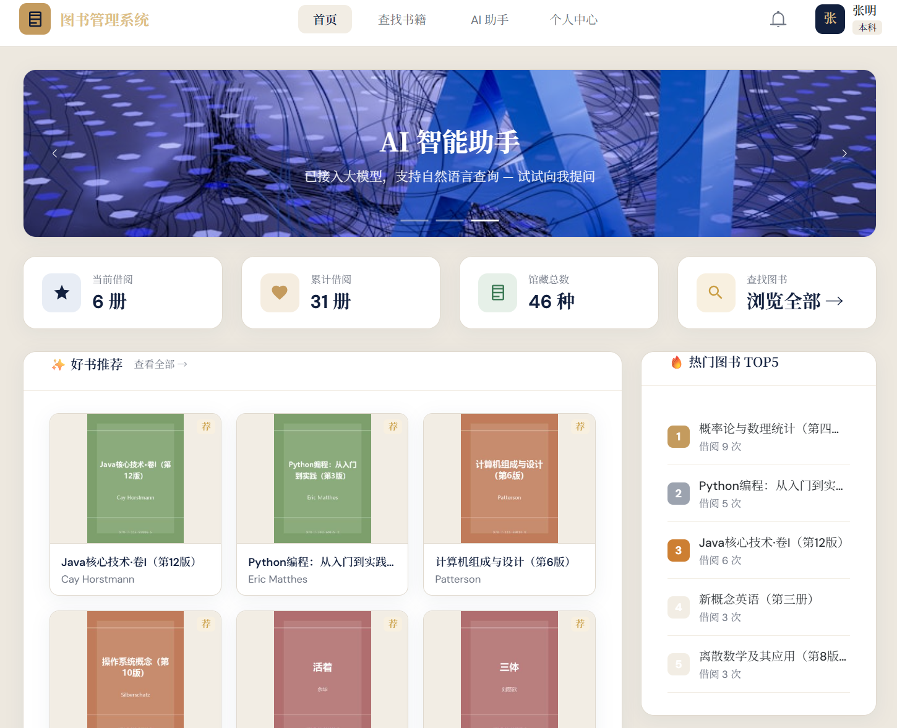
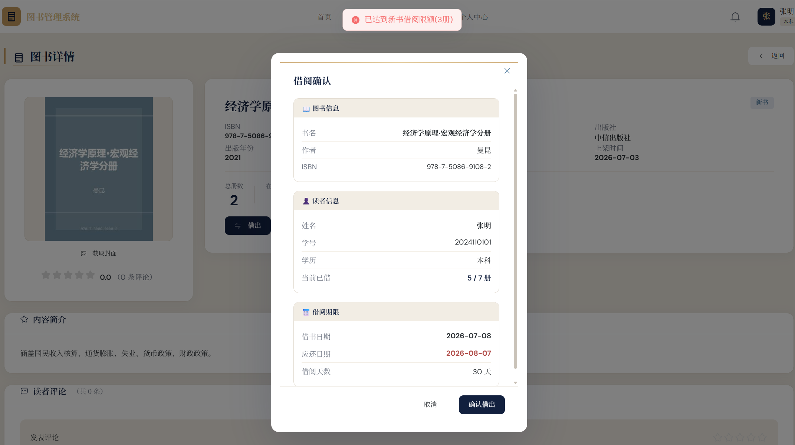
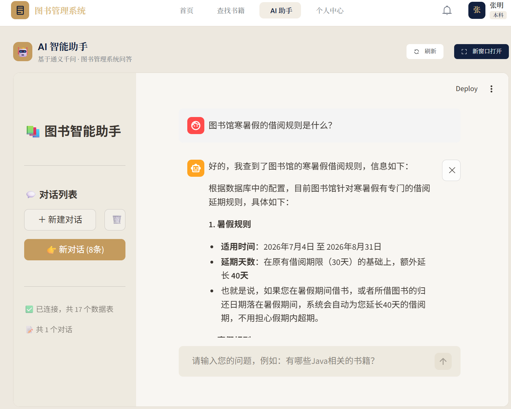
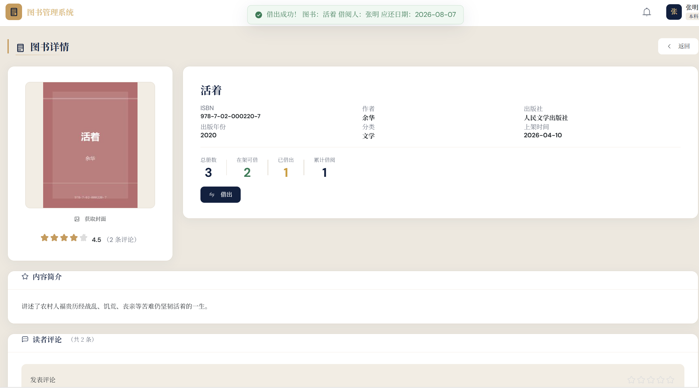

# 图书管理系统

集美大学计算机工程学院 · 软件工程专业课程设计。Spring Boot 3 + Vue 3 + MySQL 8 的图书馆流通管理系统：读者端馆藏检索、借阅续借、AI 问答；管理端图书上架、用户与借阅管理、统计报表。根目录 `docker compose up` 可一次拉起六个服务（MySQL / Redis / MinIO / 后端 / 前端 / AI 助手），种子数据 398 行，开箱即可演示。

## 界面

| 读者端首页：好书推荐 + 热门图书 TOP5 | 借阅确认：按学历算出的配额与期限 |
|---|---|
|  |  |
| **AI 助手**：自然语言提问，直连 17 张表 | **借出成功**：副本状态转为借出 |
|  |  |

## 功能

**读者端**：馆藏检索与分类浏览、图书详情（封面/简介/评论评分）、在线借阅与归还、续借、个人中心（借阅历史、超期与滞纳金）、站内通知（未读数/单条已读/全部已读）、AI 问答。

**管理端**：图书与副本管理（上架下架、条码、馆藏位置）、分类管理、用户管理（学生/教师）、借阅管理（借出、归还审核、批量催还）、滞纳金管理、统计报表（总览、月度趋势、分类分布、导出）、首页轮播与好书推荐配置、借阅规则与假期延期配置。

**通用**：手机号 + 密码 / 短信验证码登录、双 Token 续期、按角色的接口鉴权（管理员/学生/教师）、每日 8:00 超期催还定时任务。

## 设计与取舍

| # | 决策 | 为什么 |
|---|---|---|
| 1 | 认证自己用 Sa-Token 做，不引 Spring Security | access 30 分钟 + refresh 7 天，`is-share: false` 每次登录独立会话，`is-concurrent: true` 允许多端并发；登录主体是「手机号 + 验证码」，Spring Security 的过滤链在这里是负担 |
| 2 | 借阅规则做成数据表，不写死在代码里 | `t_borrow_config` 5 行覆盖高职 5 册/15 天 → 本科 7/30 → 硕士 12/60 → 博士 18/90 → 教师 20/180，每档另有新书上限；调规则只改数据 |
| 3 | 并发借阅用 Redisson 锁，粒度到读者 | 锁 key 为 `borrow:user:{userId}`：同一读者串行、不同读者互不阻塞，防两个请求同时通过配额检查导致超借 |
| 4 | 书目与副本分表 | `t_book` 是书目，`t_book_copy` 是每一本实体书（条码/楼层/架号/状态）；借阅记录只指向副本，同一书目可同时被多人借走 |
| 5 | AI 助手走 Text-to-SQL，不上向量库 | 要查的数据本来就在 MySQL 里：读表结构（含字段注释）→ LLM 生成 SELECT → 白名单校验只放行 SELECT → 执行。省掉向量库与 embedding 的运维，问答直接命中实时数据 |

代价：第 5 条的准确率取决于表结构可读性，所以本项目字段注释写得比一般课设细（`schema.sql` 里 85 个列带注释）；跨表复杂分析仍可能生成错 SQL，助手会把语句显示出来供核对。

## 架构

```
┌──────── Vue 3 + Vite（:3000 dev / :80 nginx）────────┐
│  views/  api/  stores(Pinia)  ECharts 报表           │
└───────────────────────┬──────────────────────────────┘
               /api 代理（axios → :8080/api）
┌───────────────────────▼──────────────────────────────┐
│  Spring Boot 3.2.5（:8080，context-path=/api）       │
│  Controller → Service（业务与校验）→ Mapper           │
│  Sa-Token 双 Token ｜ Redisson 锁 ｜ Knife4j 文档     │
└────┬──────────────┬──────────────────┬───────────────┘
  MySQL 8         Redis 7           MinIO（封面）
  17 表/10 外键   缓存/锁/验证码     对象存储
```

AI 助手另起 Streamlit（:8501，可选）：LangChain + DeepSeek，读 schema → 生成 SELECT → 执行；会话历史存 SQLite，`mcp_server` 暴露表结构与 CRUD 工具。

一次借书请求：`POST /api/borrows` → Sa-Token 校验 → 取 Redisson 锁 `borrow:user:{userId}` → 用户状态（禁用/超期锁定）→ 副本在架 → 借阅配额 → 新书配额 → 写 `t_borrow_record`（status=1）→ 更新 `t_book_copy.status=2` → 释放锁。

## 快速开始

### 方式一：Docker（推荐）

```bash
cat > .env <<'EOF'                      # 在仓库根目录执行
MYSQL_ROOT_PASSWORD=your_password
MINIO_ROOT_USER=minioadmin
MINIO_ROOT_PASSWORD=minioadmin
DEEPSEEK_API_KEY=
EOF

docker compose up -d                    # MySQL / Redis / MinIO / 后端 / 前端
docker compose --profile rag up -d      # 需要 AI 助手时追加
```

前端 `http://localhost`，后端 `http://localhost:8080/api`，MinIO 控制台 `http://localhost:9001`，AI 助手 `http://localhost:8501`。首次启动自动执行 `schema.sql` 与 `data.sql`。

### 方式二：本地启动

```bash
# 数据库（schema.sql 自带 CREATE DATABASE，可直接执行；两个脚本顺序不能反）
mysql -u root -p < database/schema.sql
mysql -u root -p < database/data.sql

# 后端：必填环境变量 + MinIO 凭据
export SPRING_DATASOURCE_PASSWORD=your_password
export MINIO_ACCESS_KEY=minioadmin MINIO_SECRET_KEY=minioadmin
cd backend && mvn spring-boot:run          # :8080

cd frontend && npm install && npm run dev  # :3000，/api 已代理到 8080

# AI 助手（可选）
cd rag-project && pip install -r requirements.txt
export DEEPSEEK_API_KEY=sk-xxx && streamlit run app.py --server.port 8501
```

| 环境变量 | 用途 | 缺省后果 |
|---|---|---|
| `SPRING_DATASOURCE_PASSWORD` | MySQL 密码 | 启动即失败（配置无默认值） |
| `MINIO_ACCESS_KEY` / `MINIO_SECRET_KEY` | MinIO 读写凭据 | 启动即失败 |
| `DEEPSEEK_API_KEY` | AI 助手调用 DeepSeek | 仅 AI 助手不可用 |

## 默认账号

| 角色 | 登录手机号 | 密码 |
|---|---|---|
| 管理员 | `13800000000` | `123456` |
| 学生（学号 `2024110101`） | `13800000001` | `123456` |
| 教师（工号 `T2001011`） | `13900000001` | `123456` |

登录一律按手机号查（`AuthServiceImpl` 走 `selectByPhone`），学号与工号用于展示和检索。密码以 BCrypt 存储；学生与教师的 `password` 字段加了 `@JsonIgnore`，不会随接口返回。支持密码与短信验证码两种登录（`/auth/login`、`/auth/sms-login`）。

## 目录结构

```
book-management/
├── backend/                    Spring Boot 后端
│   ├── API.md                  接口文档
│   └── src/main/java/com/bookmgt/
│       ├── controller/         18 个控制器，85 个端点
│       ├── service/ (+impl)    借阅校验、滞纳金、报表聚合
│       ├── mapper/ entity/     Mapper / 表映射；dto 入参、vo 出参
│       ├── common/ util/       config、result、handler；MinIO/日期/短信
│       └── scheduled/          每日 8:00 超期催还
├── frontend/src/               api / views / components / router / stores / assets
├── rag-project/                app.py、rag_core/、mcp_server/
├── database/                   schema.sql（17 表/122 列/10 外键/18 索引）、data.sql（398 行）、er-diagram.html
└── docker-compose.yml          六服务编排
```

## 数据库

- 17 张表：组织架构 `学院→专业→班级→学生`，流通主链 `书目→副本→借阅记录→滞纳金`，另有教师、管理员、分类、评论、轮播、推荐、通知、假期配置。
- `t_borrow_record.user_id` **不建外键**（可能指向学生或教师，由应用层校验）；状态：借阅 `1 借阅中/2 已归还/3 超期/4 待审核`，副本 `1 在架/2 借出/3 待上架/4 丢失`。
- `schema.sql` 可重复执行（自带 `SET FOREIGN_KEY_CHECKS=0` 并按依赖顺序建表），`data.sql` 需在空表上执行，两者顺序不能反。

## API

接口文档两处：仓库内 `backend/API.md`，运行时 Knife4j `http://localhost:8080/api/doc.html`。全部 85 个端点分属 18 个控制器。

| 分组 | 代表端点 |
|---|---|
| 认证 | `POST /auth/login`、`POST /auth/sms-login`、`POST /auth/refresh` |
| 图书与副本 | `GET /books`、`GET /books/isbn/{isbn}`、`POST /books/{id}/fetch-cover` |
| 借阅与滞纳金 | `POST /borrows`、`PUT /borrows/{id}/return`、`PUT /borrows/{id}/renew`、`GET /fines` |
| 报表 | `GET /reports/overview`、`GET /reports/monthly-trend`、`GET /reports/category-distribution` |
